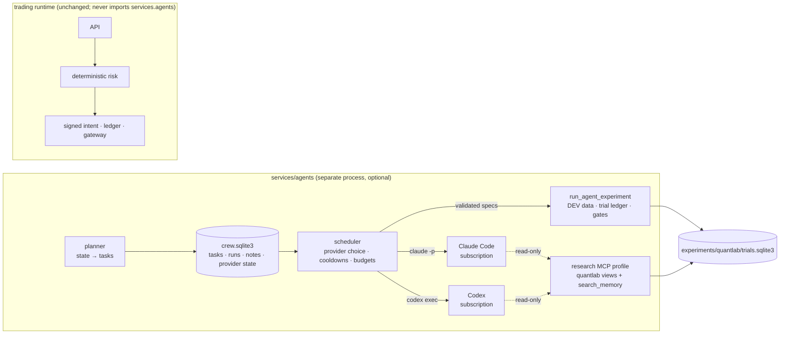

# Research crew: Claude Code + Codex agents for research, review and improvement

Status: implemented 2026-11-25 (see the PROGRESS entry). Research only. The crew has no execution authority.

## Why this shape

An audit of the runtime on 2026-11-25 found most of the research machinery already present: a closed factor DSL
(`services/quantlab/factors.py`), a trial ledger with deflated-Sharpe, SPA and PBO gates, duplicate and redundancy
refusal (`novelty.py`), a protected holdout (one look per spec), and persistent trading memory (`services/memory`).
Five subscription and API AI runtime modes are documented in ADR 0002.

The missing piece was coordination. Before this change, nothing decided *what* to research next, dispatched the
work to whichever subscription had capacity, had a different provider check the result, or kept the agents' own
reasoning between sessions. The crew adds that and nothing more. It adds no new database engine, queue, server,
model API client or orchestration framework.

## Principles

* **Trading runs independently of agent availability.** The trading runtime (`services/api`, risk, ledger,
  positions and sessions) never imports `services.agents`. The crew never imports those packages either, and tests
  enforce both directions. The crew does not need the API to be running and never starts or restarts it. Agents get
  the `research` MCP profile, which runs in-process over the quantlab artifacts and the memory store and lists no
  trading tools. Agents therefore cannot propose, cancel or halt, and they cannot start sessions.
* **Agents propose, deterministic code decides.** A hypothesis agent returns declarative factor specs. The crew
  validates each spec with `validate_spec`, then runs it through `run_agent_experiment`, the same path, hourly
  budget, duplicate and redundancy refusal, and gates as the `run_research_experiment` tool. The crew records the
  ledger's result, never the numbers an agent reports. The crew never opens a holdout or promotes a strategy, and it
  never changes risk policy.
* **Independent review across providers.** A spec that the trial ledger accepted gets a `review` task. The planner
  assigns it to the other provider. When that provider is unavailable, the review waits, and after
  `LAT_AGENTS_REVIEW_WAIT_HOURS` it expires as `CANCELLED (no independent reviewer)`. Self-review is not allowed.
  Reviews are advisory. They feed the planner and the operator, and the deterministic gates stay authoritative.
* **Roles are task kinds, not a fixed hierarchy.** `hypothesis`, `review`, `market_analysis` and `improvement`
  are task kinds that either provider can take. The planner derives tasks from state: unreviewed results, scan
  artifacts that changed, ledger headroom, and new failures since the last improvement pass. The scheduler picks a
  provider for each task.
* **Quota is the scarce resource.** The crew starts no agent when no task has new evidence to work from. One agent
  runs at a time by default (`LAT_AGENTS_MAX_CONCURRENT`), within a per-provider daily run cap. A task needs
  experiment headroom before the agent starts, so budget is never spent on specs the hourly limit would refuse. Each
  task asks for at most `LAT_AGENTS_SPECS_PER_TASK` specs, and its context is a compact digest instead of raw
  artifacts.
* **Graceful recovery from usage limits.** `USAGE_LIMIT`, `AUTH_REQUIRED` and `UNAVAILABLE` requeue the task
  without consuming an attempt. They also put the provider on a cooldown: until the reset time the CLI printed if
  there was one, otherwise until an exponential backoff (`LAT_AGENTS_COOLDOWN_MINUTES`, doubled per consecutive
  limit, capped at 12 h) expires. The other provider keeps working. On restart, a task left `RUNNING` returns to
  `QUEUED`. The crew never retries in a tight loop.
* **Shared persistent memory.** `experiments/agents/crew.sqlite3` holds append-only notes (hypotheses, findings,
  reviews, data requests and improvement proposals) with their provider, mechanism and evidence links. Every prompt
  receives a sanitized digest of recent notes, the trial-ledger summary and the per-mechanism record, so each agent
  sees what the other provider tried and why it failed. Notes carry the label `evidence_status=AGENT_NOTE`. They
  never become facts, signals or validation. Agents can also query trading memory through `search_memory`.
* **Subscriptions through supported sign-in only.** The crew runs the operator's installed `claude` and `codex`
  CLIs, which use their own sign-in. The crew never reads, copies or stores tokens, and it removes
  `ANTHROPIC_API_KEY`, `OPENAI_API_KEY` and similar keys from the child environment so that usage goes to the
  subscription instead of silent API billing. Model output and tool output are treated as data.

## Orca

Orca coordinates the *engineering* of this repository: workers, cross-provider reviews and worktrees. The runtime
crew calls the CLIs directly so that it runs headless under `make agents` or the supervisor without the desktop app.
Improvement proposals are written for the operator, who can hand them to Orca workers. The crew never edits code.

## Interfaces

* `services/agents/contracts.py`: provider protocol, invocation and result, task and run enums.
* `services/agents/providers.py`: `ClaudeCodeProvider` and `CodexProvider` (headless, structured output,
  usage-limit detection, scrubbed environment, read-only research MCP). `fake.py` has a scripted `FakeProvider`
  for tests and `run --fake`.
* `services/mcp_server --profile research`: the read-only research tool profile (`RESEARCH_TOOL_NAMES`), in-process,
  with no API or agent token.
* `services/agents/store.py`, `planner.py`, `context.py`, `schemas.py`, `crew.py`, `prompts/`: the queue, the
  planning, the prompts and the loop.
* CLI: `python -m services.agents {run [--once] | status | notes | enqueue | providers}`. The Make targets are
  `agents`, `agents-once` and `agents-status`.

## What it does not do

The crew does not run generated code, apply code changes, use a GUI agent, call paid model APIs or touch the holdout.
It does not trade or change modes or risk limits. Agents in the Codex sandbox can still read files that the process
user can read. Holdout integrity rests on the deterministic holdout ledger, not on agent confinement.
