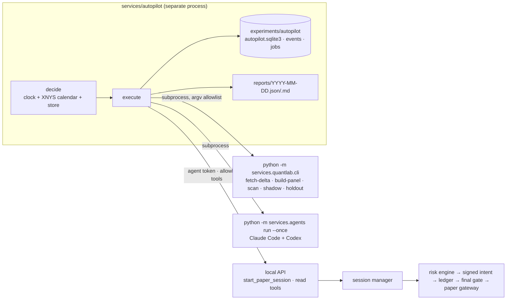

# Autopilot: the autonomous multi-agent orchestrator

Status: implemented 2026-11-25 (`services/autopilot`). Paper only. Off until the operator sets
`LAT_AUTOPILOT_ENABLED=true`.

## Purpose

The autopilot is a multi-agent orchestrator that runs research and paper trading by itself every XNYS trading
day. The operator does not need to issue commands. Before the open it checks that the system is healthy, then
requests the day's bounded PAPER session. During regular hours it observes. After the close it runs the QuantLab
daily pipeline, summons the Claude Code and Codex research crew for a bounded number of ticks, updates the
prospective shadow journal, and lets the existing deterministic gates promote a strategy where they allow it. It
then writes a daily report.

The autopilot is a **deterministic supervisor**. It has no language model of its own. Its daily plan is a pure
function of the wall clock, the XNYS calendar and its own SQLite store, and `python -m services.autopilot plan`
prints that plan, with reasons, without running anything.

The AI work is led by one **lead agent** ([lead-agent.md](lead-agent.md)). The autopilot launches it as a background
child from the pre-open until the evening research window ends. The lead decides tasks, priorities and subagent
roles from the evidence and delegates them to parallel Claude Code and Codex subagents. It replaces the fixed
evening crew ticks. The only lead output the autopilot acts on is a validated fail-safe request (stand down today,
or request a halt). The pre-open, the session and every deterministic research step run the same without it.

## Daily state machine (America/New_York, XNYS)

| Phase | Window | What the autopilot does |
| --- | --- | --- |
| Pre-open | open − `PREOPEN_LEAD_MIN` (60) to open + `START_GRACE_MIN` (5) | Inspects the API for an existing session or schedule today and adopts it, so it never creates a duplicate. Checks for halts, the kill switch, entries locks, health (broker, reconciliation, database, engine, scheduler) and the feed. If every check passes, it calls `start_paper_session` once. The session ends by the entry cutoff: the full regular session minus the last 30 minutes (`ENTRY_CUTOFF_BEFORE_CLOSE_SECONDS`). On a failed check it records the reason, raises one alert and re-checks at most every `PREOPEN_RECHECK_MIN`. |
| Regular | open to close | One bounded status check (session status and risk status) per `INTRADAY_INTERVAL_MIN` (15). The autopilot only observes. It never cancels, stops, flattens or proposes. |
| Post-close | close to close + `SETTLE_MIN` (30) | Waits for the data to settle. |
| Quiet | close + settle to 90 min before the next open | Runs one research step per tick, in order: the QuantLab daily pipeline (skipped when the API already runs it), the crew ticks (only when the lead agent is off), the shadow journal, then at most one holdout look. After that it writes the final report. |
| Lead (all of the above) | pre-open to 90 min before the next open | One lead-agent cycle at a time, in the background, when due: the first turn of the day, the lead's requested wake time, new evidence or the maximum interval, at least `LEAD_MIN_INTERVAL_MIN` apart and at most `LEAD_MAX_CYCLES` per day. Paused in stand-down. |

Holidays have no session, so nothing trades. Thanksgiving (2026-11-26) is entirely Wednesday's research window.
Early closes use the real close: on 2026-11-27 the session runs 09:30–12:30 ET (180 minutes) and research starts
at 13:30. A window missed while the Mac slept or the autopilot was down becomes MISSED. **No trading ever happens
late.** Research catches up once: a day whose research never ran is SUPERSEDED, and the next evening's run
covers it, because the steps are incremental. A day is never replayed on its own.

## Hard boundaries (enforced in code and tests)

1. **The autopilot uses only the agent identity.** It reads `var/<ns>/keys/agent.token` through the MCP server's
   own `HttpToolBackend`, with actor `autopilot`, so sessions record `requested_by=agent:autopilot`. It never
   holds, reads or sends the operator token.
2. **One mutating tool can start trading, and two can only reduce it.** `GuardedBackend` permits read tools,
   `start_paper_session` (called only by the deterministic pre-open step), and the fail-safe `stop_session` and
   `request_halt`. The fail-safe tools are used only to carry out a validated lead-agent request, at most once each
   per day, and only for today's autopilot session. Each tool's fields are allowlisted. The autopilot cannot cancel
   or propose orders, clear halts, schedule, run research experiments or change policy. The registry gives it no
   way to resume trading or flip the kill switch.
3. **It never changes risk policy, never clears halts and never touches the kill switch.** It requests a halt only
   when the lead agent asks for one. Any active halt, of
   ENTRIES or ALL scope, puts it into stand-down: no session request and no research step. It leaves stand-down
   only when a later read-only check shows the operator cleared the halt.
4. **It never selects Live.** `require_paper_runtime` refuses to run unless the runtime is Paper on the FAKE or
   ALPACA_PAPER gateway. The autopilot never sets a mode or gateway variable, and Live stays compiled off.
5. **It never calls a broker.** It does not import any gateway, the order ledger, positions, the risk engine,
   `policy_store`, `operator_auth`, the API app or runtime, or the crew. Every order still goes through
   RiskEngine.evaluate, the signed intent, the ledger claim, the final gate and the paper gateway inside the API.
6. **It runs only allowlisted subprocesses:** `services.agents run --once --json`,
   `services.agents lead --json --budget-s N --briefing <state_dir>/lead/briefing.json [--fake]`, and
   `services.quantlab.cli` with one of `fetch-delta`, `build-panel`, `scan`, `shadow` or `holdout --family F`.
7. **It never bypasses a gate.** A family gets a holdout look only if it is `DEV_PASSED` in the registry. The
   autopilot records its attempt *before* the child starts and never tries that family again, and the vault
   independently refuses a second look. SHADOW → PAPER happens only inside the existing `shadow` step's
   `promotion_check`. Crew notes are proposals and never promote anything.

`tests/unit/autopilot/test_authority.py` checks boundaries 1, 2, 4, 5 and 6. It scans the package's imports and
literals, probes `sys.modules` after importing every module and its lazy paths, tests the tool and argv
allowlists, and confirms over a mock transport that only the agent token is sent. Stand-down, idempotency and
gate behaviour are tested in `test_preopen.py` and `test_intraday_research.py`.

### Why these boundaries exist

* **There is no demonstrated edge yet.** Every QuantLab family has failed its development gate so far, and the
  protected holdout is unopened. Autonomy is allowed to operate the machinery, but not to decide that a strategy
  works. Only the pre-registered deterministic gates can decide that. Paper is the only venue that fits this state
  of evidence.
* **Market text can carry prompt injection.** News, filings, symbols and tool outputs can contain
  instruction-shaped text, and the research crew reads such material. The autopilot therefore treats every tool
  output and agent note as data, holds no model, and keeps every authority (orders, policy, halts, mode) out of
  reach of anything an agent writes.
* **Losses are irreversible.** A wrong order cannot be undone, and a cleared halt can hide a real problem.
  Halting is the fail-safe direction and stays open to the operator and to agents. Resuming, policy changes and
  the kill switch remain operator-only, behind operator authentication and a CLEAN broker reconciliation.

## Durability

* Its own SQLite store is `experiments/autopilot/autopilot.sqlite3`. The `events` table is append-only: UPDATE
  and DELETE abort in triggers. `jobs` holds one row per (day, job), and terminal rows are never reopened. `kv`
  holds small state values.
* A single-instance `flock` on `experiments/autopilot/autopilot.lock` lets only one `run` loop work at a time.
  `status` and `plan` read without the lock.
* Jobs resume after a crash. A pre-open job left RUNNING or UNKNOWN always re-inspects the API first: it adopts
  the session if one exists. It retries only when the API shows no session, and at most 3 times. It never resends
  blindly. Research steps retry hourly, at most 3 times. The crew-tick count and the holdout attempt are persisted.
* The loop sleeps at most `TICK_S` (60 s) and re-reads the wall clock after every sleep and before every action. A
  sleeping Mac stops the monotonic clock, so a jump in the wall clock is logged as `SLEEP_GAP`.
* Each research child has a timeout. The timeout is also cut short at 5 minutes before the next pre-open, so
  research never delays the session request.

## Interfaces

* `python -m services.autopilot run`: the supervisor loop. `run --once`: one tick, then exit.
* `status [--json]`: read-only: lock holder, phase, jobs, stand-down, alerts and next actions. No API calls.
* `plan [--json] [--at ISO]`: a dry run of the next tick. No API calls and no writes.
* Reports: `experiments/autopilot/reports/YYYY-MM-DD.{json,md}`. Each report covers the session outcome, equity,
  P&L, orders, rejections by check, research families, crew runs, promotions, alerts, stand-down, and data
  provenance with execution labels. A simulated day carries a SIMULATED label at the top.

Configuration (`LAT_AUTOPILOT_*`) and operations: [runbook](../runbooks/autopilot.md).
