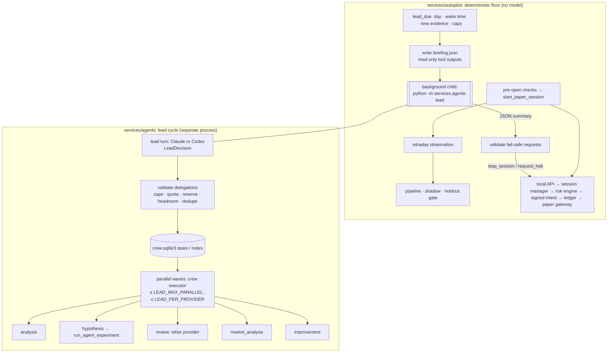

# Lead agent: one autonomous AI lead over the trading day

Status: implemented 2026-11-25 (`services/agents/lead.py`, `services/autopilot/lead.py`). Paper only. It runs when
the autopilot runs (`LAT_AUTOPILOT_ENABLED=true`) and `LAT_AUTOPILOT_LEAD=true`, which is the default.

## Why this shape

Before this change the AI work was a fixed workflow. The autopilot ran *N* crew ticks every evening, and the crew's
rule-based planner decided what each tick did: a review for every accepted hypothesis, a UCB-chosen mechanism, one
market analysis per scan and an improvement pass after 10 failures. Nothing looked at the trading session, and no
model chose what to work on.

Now one **lead agent** decides. The autopilot, which is the daily scheduler, wakes it from the pre-open until the
evening research window ends. Each turn the lead reads the evidence, ranks priorities, invents the roles and
questions it needs, and delegates them to parallel Claude Code and Codex subagents. The trading engine, research
pipeline, memory, budgets and risk controls are reused unchanged. Trading does not depend on the lead.

## One cycle

1. **Briefing.** The autopilot reads session status, risk, performance, health, feed and today's session report
   through its guarded read tools. It adds its own jobs, alerts and recent events and writes
   `experiments/autopilot/lead/briefing.json` with the file mode set to 0600. The file has execution labels, and
   it contains no credentials.
2. **Lead turn** (`LeadAgent._lead_turn`). One headless run goes to the first lead provider in
   `LAT_AGENTS_LEAD_PROVIDERS` that is signed in, not cooling down and under its caps. On a usage limit the provider
   cools down and the next one leads. The prompt (`prompts/lead.md`) holds the quoted briefing, the subscription
   and experiment budget, the results of earlier delegations, the hypotheses waiting for review, the lead's own
   journal and memory notes, and the crew digest. The answer is a `LeadDecision`: situation, priorities,
   delegations, fail-safe session requests, memory notes and `next_wake_minutes`.
3. **Validation** (`LeadAgent.apply`). Each delegation chooses a **capability** (`analysis`, `hypothesis`, `review`,
   `market_analysis` or `improvement`). The capability fixes the output schema and how deterministic code handles
   the result. The lead writes the **role, objective and instructions** itself. Code refuses a delegation for any
   of these reasons, and records each refusal:
   - it exceeds the per-cycle or per-day cap (`OVER_CYCLE_CAP`, `OVER_DAILY_CAP`);
   - no quota is left after the lead's reserve (`NO_QUOTA`);
   - an expressible hypothesis has no experiment headroom (`NO_EXPERIMENT_HEADROOM`);
   - the mechanism is unknown (`UNKNOWN_MECHANISM`);
   - a review has no reviewable subject, or its subject is already reviewed (`NO_REVIEWABLE_SUBJECT`,
     `ALREADY_REVIEWED`);
   - the same role and objective were already delegated today (`DUPLICATE_TODAY`);
   - its text contains high-severity injection (`WITHHELD_OR_EMPTY_TEXT`).
   Accepted delegations become ordinary crew tasks, which expire after 24 h.
4. **Delegation** (`run_delegations`). The crew executor runs the queued tasks in parallel waves until nothing more
   can start or the cycle's `--budget-s` deadline arrives. No run starts if it could not finish in time. The crew's
   existing safeguards apply: provider choice, cooldowns, review by the other provider, `validate_spec`, the
   `run_agent_experiment` path (development data, the hourly budget, duplicate and redundancy refusal, the gates)
   and `AGENT_NOTE` labelling.
5. **Back in the autopilot** (`_poll_lead`). The summary is reduced to scalars and short strings. The autopilot
   records the lead's requested wake time, clamped to the min and max interval. It executes only validated
   fail-safe requests.

## Pacing and subscription limits

| Limit | Default | Enforced by |
| --- | --- | --- |
| Lead turns per trading day | 10 (`LAT_AUTOPILOT_LEAD_MAX_CYCLES`) | autopilot `lead_due` |
| Gap between cycles | at least 20 min, at most 180 min | autopilot `lead_due` |
| Wake triggers | first turn of the day, the lead's own wake time, new results, alerts, decisions or stand-down changes | autopilot event log |
| One cycle at a time | the next cycle waits for the running child | autopilot, crew store lock |
| Cycle wall clock | 2700 s (`LAT_AUTOPILOT_LEAD_TIMEOUT_S`) | child `--budget-s`, crew deadline |
| Runs per provider per day | 12 (`LAT_AGENTS_DAILY_RUNS_PER_PROVIDER`) | crew `eligible_providers` |
| Runs per provider per rolling window | 8 per 5 h (`LAT_AGENTS_WINDOW_RUNS_PER_PROVIDER`, `_WINDOW_HOURS`) | crew `eligible_providers` |
| Lead reserve | the last 2 runs of each cap go only to lead turns (`LAT_AGENTS_LEAD_RESERVE_RUNS`) | crew `eligible_providers` |
| Parallel subagents | 3 in total, 2 per provider | crew `tick` |
| Delegations | 4 per turn, 16 per day | lead `apply` |
| Usage limit | the provider cools down until the stated reset, or with exponential backoff; the other provider leads | crew `_cool_down` |
| Agent experiments | 6 per hour | quantlab `run_agent_experiment` |

The lead sees the remaining budget in every briefing. It is told that no delegation is a good answer on a quiet
turn.

## What the lead can and cannot do

The lead can request two **fail-safe** session actions. The autopilot validates and executes each at most once per
trading day:

* `stand_down_today`: if today's session has not been requested yet, the pre-open job becomes `SKIPPED`. If today's
  **autopilot** session is active, it is stopped with `stop_session`. Positions, protective stops and exits are not
  touched. An operator's session is never stopped. This is refused while a start outcome is still unresolved, or
  when the lead turn was for another day.
* `request_halt`: new entries halt until the operator lifts the halt after a clean reconciliation. The autopilot
  then stands down, and the lead pauses with it.

`LAT_AUTOPILOT_LEAD_SESSION_ACTIONS=false` turns both off. The lead **cannot** start, resume or resize trading. It
cannot propose or cancel orders, schedule sessions, change risk policy, modes or limits, clear halts, touch the kill
switch, open the protected holdout or promote a strategy. The autopilot's `GuardedBackend` allows read tools,
`start_paper_session` (called only by the deterministic pre-open step), `stop_session` and `request_halt`, and
refuses every other tool and every field outside each tool's contract. The lead process imports no trading code.
`tests/unit/agents/test_import_boundaries.py` checks this.

## Trading is independent of AI availability

* The autopilot decides the pre-open before it decides whether a lead turn is due. The session request is made
  before a lead child is launched, in the same tick.
* The lead runs as a background child. The autopilot never awaits it inside a tick. A hung, slow, rate-limited or
  crashing lead delays no pre-open, intraday check, pipeline step, shadow update, holdout gate or report.
  `test_session_is_requested_and_observed_while_the_lead_hangs` checks this.
* A failed or unavailable lead raises one alert and falls back to the maximum interval. Its output is not acted on.
* When `LAT_AUTOPILOT_LEAD=false`, the old fixed crew ticks run in the evening instead.

## Memory

The lead uses the crew store (`experiments/agents/crew.sqlite3`, append-only notes):

* `lead_journal`: one entry per turn, holding the situation, priorities, what was delegated or refused, the session
  requests and the wake time.
* `lead_memory`: durable lessons. The last 12 come back in every briefing.
* `delegation` and `lead_refusal`: bookkeeping entries (`CREW_EVENT`).
* `analysis`: subagent findings (`AGENT_NOTE`).

Every agent also has `search_memory` over the trading memory (`services/memory`). All agent text is sanitized and
quoted as data before it reaches another model.

## Operations

* `make autopilot-status` shows the lead state (cycles, next wake, actions taken). `make agents-status` shows the
  last lead turn and the per-provider window usage.
* `python -m services.agents notes --kind lead_journal` shows what the lead decided and why.
* `make agents-lead-fake` runs a demo cycle with simulated providers, using a separate store and spending no
  quota.
* For a disposable simulated run of the whole chain, set `LAT_AUTOPILOT_LEAD_FAKE=true`. The integration test
  `tests/integration/autopilot/test_run_once_simulated.py` does this.
