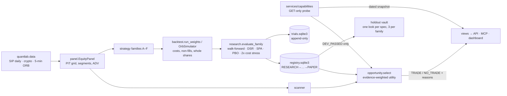

# Multi-asset research and opportunity selection (quantlab)

Research-only layer that investigates what Alpaca actually supports, compares strategy families after realistic
costs, and selects the strongest *validated* opportunity — or `NO_TRADE`. It has no order, broker-write or
risk-policy authority. Execution stays: proposal → independent `RiskEngine` → signed intent → ledger → gateway.

## 1. Capability verification (`services/capabilities`)

`python -m services.capabilities probe` queries the PAPER trading API (account, configurations, assets incl.
inactive, option contracts for equity/ETF/index roots) and the data API (SIP historical, IEX/SIP latest quotes,
crypto bars + order book, indicative vs OPRA option snapshots, news, corporate actions, screener). Every asset
class gets four independent layers — `api_schema`, `market_data`, `account_permission`, `policy_execution` —
and two derived flags: `research_eligible` (data available) and `execution_eligible` (all four OK).

Observed on 2026-11-23 (paper account, free data plan):

| Asset class | Data | Account | Policy / execution stack | Research | Execution |
|---|---|---|---|---|---|
| U.S. equity long | SIP historical, IEX real-time | ACTIVE | LIMIT DAY long-only, 24-symbol allowlist | yes | yes |
| U.S. equity short | as above | shorting enabled | `long_only` invariant | yes | no |
| Margin borrowing | — | multiplier 4 | `allow_margin` invariant | yes | no |
| Leveraged / inverse / volatility ETPs | equity bars | ACTIVE | hard denylist | yes | no |
| Crypto spot (73 pairs, 33 non-stable USD) | bars + order book | `crypto_status` ACTIVE, tier 1 | not implemented in risk engine / ledger | yes | no |
| Options (equity, ETF; SPX/XSP/VIX European) | indicative only; OPRA **denied** | level 3 | `allowed_order_types == (LIMIT,)` on equity symbols | yes (prospective) | no |
| Extended / overnight hours | IEX | allowed | `regular_session_only` invariant | yes | no |

NDX and RUT index options returned no contracts. Real-time SIP quotes are denied ("subscription does not permit
querying recent SIP data"). PDT fields are absent: FINRA replaced the pattern-day-trader rule with intraday margin
standards (Rule 4210, effective 2026-06-04) and Alpaca deprecated `pattern_day_trader` / `daytrade_count`.
Nothing was enabled by this work; enabling any `NO` above is an operator decision behind the existing controls.

## 2. Point-in-time data (`quantlab.data`, `quantlab.panel`)

* Daily SIP bars since 2016 for every active research instrument **and** every delisted/renamed symbol recovered
  from corporate actions (mergers, worthless removals, name changes) — SIVB, FRC, TWTR etc. keep their history.
  Corporate-action coverage starts after 2016, so survivorship bias is reduced, not eliminated.
* `raw` bars give as-traded price levels for filters and costs; `all` (split + dividend adjusted) bars give total
  returns. Adjusted bars are fetched only for symbols that ever reached $5M/day at ≥ $3 (a superset of every
  research universe, which start at $20M).
* Panel rules: XNYS session grid; a gap > 10 sessions or an unexplained |log return| > 1.2 starts a new segment
  (ticker reuse, bad prints); ADV uses sessions strictly before *t*; decisions at the close of *t* trade at *t+1*.
* Manifests record request parameters, fetch (knowledge) time, row counts and SHA-256 per file; datasets are
  immutable (a parameter change requires a new directory).

## 3. Strategy families

| Family | Idea | Variants | Execution form today |
|---|---|---|---|
| A_momentum | cross-sectional 12-1 / 6-1 / 3-month / residual / blended momentum; SMA-200 or vol-scaled regime; top 10/30; weekly/monthly | 120 | multi-day (blocked by lifecycle) |
| A2_etf_rotation | allowlisted asset-class/sector ETF rotation, absolute-momentum filter, 1–3 holdings | 72 | multi-day |
| B_orb | stocks-in-play 5/15-minute opening-range breakout, relative-volume, VWAP/SPY confirmation | 32 | intraday, same session |
| C1_weekly_reversal | weekly-loser reversal among large caps, high-vol / uptrend regimes | 32 | multi-day |
| C2_pullback / C3_etf_pullback | RSI(2) pullback in an uptrend (stocks / index ETFs) | 24 / 12 | multi-day |
| D1/D2 crypto | time-series momentum with vol targeting; cross-sectional momentum across pairs | 48 / 36 | research / shadow only |
| E options | BS/Black-76 + CRR American pricing, IV, Greeks, HAR-RV forecast, IV−RV premium, skew, term structure, defined-risk verticals at executable touch | prospective scan | research only |
| F_agent | agent-proposed factor specs in a closed expression language (no code execution) | per request | development only |

## 4. Validation (`quantlab.validation`, `quantlab.gates`, `quantlab.ledger`)

Pre-registered gates are code constants. Development: deflated Sharpe ≥ 0.95 on the walk-forward OOS series with
**every** family trial counted (trial ledger), walk-forward OOS Sharpe ≥ 0.5, Sharpe-differential SPA p ≤ 0.10
vs the passive benchmark **or** Newey-West alpha t ≥ 2, PBO ≤ 0.5, Sharpe > 0 at 2× costs, max drawdown ≥ −35 %,
≥ 50 trades, and Benjamini-Hochberg survival across families. Holdout (2025-11-21 … 2026-11-20, registered once,
immutable): one look per spec, three per family, committed before evaluation; positive net return and Sharpe,
drawdown within 1.5× development. Then SHADOW (prospective journal) for ≥ 20 sessions before a PAPER request.

## 5. Unified opportunity contract (`quantlab.opportunity`)

Every candidate is expressed per unit of capital over its own horizon (gross, cost, net, std, CVaR95, max loss,
capital, buying-power effect, exposure multiple, capacity, fill probability, slippage, evidence, executability).
Ranking: `dU = w·μ − γ/2·(w²s² + 2wρ s σ_book w_book)` with `s = max(σ, CVaR95/2.063)` and μ shrunk by evidence
(VALIDATED 1.0, SHADOW 0.75, DEV_PASSED 0.25, research-only/rejected 0). Leveraged ETFs carry volatility drag;
options use payoff-scenario moments and max-loss budgets. Only executable, evidence-bearing candidates with
positive utility are selectable; otherwise `NO_TRADE` with per-candidate reasons.

## 6. Interfaces

* CLI: `python -m services.quantlab.cli fetch-equities | fetch-crypto | crypto-spreads | build-panel | research
  [--asset equity|crypto|orb] | holdout --family F | scan | crypto-scan | options-scan | orb-fetch | experiment`.
* API (read-only): `GET /api/v1/quantlab/{capabilities|research|opportunities|strategies|trials|options}`.
* MCP / agent tools: `get_capabilities`, `get_research_results`, `get_opportunities` (read) and
  `run_research_experiment` (development-only, budgeted, recorded; category `research`).
* Dashboard: "Multi-asset research" panel (GET only).
