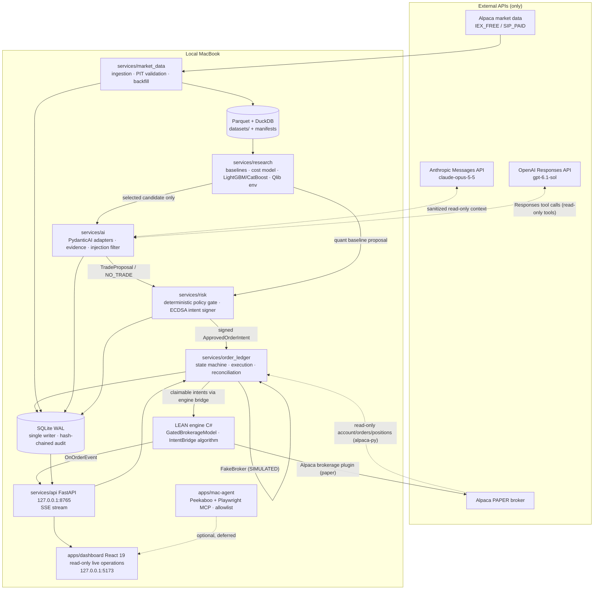
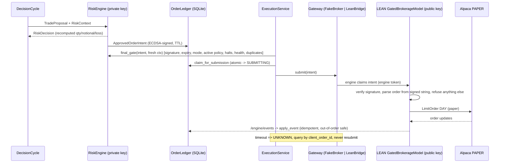

# Architecture overview

Everything runs on this Mac. External calls: model APIs (opt-in), Alpaca market data, Alpaca paper broker.

## Order path and trust boundaries

## Security boundaries
| Boundary | Enforcement |
|---|---|
| Models ↔ broker | Models get sanitized read-only tools only; no order/limit tools exist (tool-surface test). No credentials in prompts. |
| Proposal → order | Only `RiskEngine.authorize` can sign (private key 0600 in `var/<ns>/keys`). Gateway + LEAN verify with the public key. |
| LEAN strategy → broker | `GatedBrokerageModel.CanSubmitOrder` refuses any order not matching a valid signed intent. |
| Paper ↔ live | Compile-time `LIVE_EXECUTION_COMPILED=False`; separate namespaces, keys, DBs, secret names; live gateway always denied; paper key ids `PK…` required. |
| Operator ↔ automation | Operator token (human only) for resume/policy/cycle; engine token (LEAN only) for the bridge; neither given to models or the GUI agent. |
| GUI agent | App/domain allowlist, element-level denial of order controls, scrubbed subprocess env, no shell access. |
| Network | API and dashboard bind `127.0.0.1`; CSRF header + origin checks on POST. |
| Restart/sleep | Entries locked until broker-authoritative reconciliation is CLEAN; SUBMITTING-at-crash ⇒ UNKNOWN ⇒ resolved by client order id, never resubmitted. |
